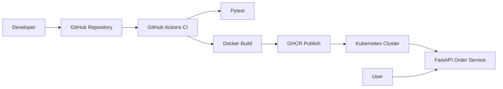

# DevOps CI/CD and Kubernetes Deployment Lab

A hands-on DevOps portfolio project that packages a small FastAPI order service with automated tests, containerization, CI/CD, and Kubernetes deployment manifests.

## Problem Statement

Build a simple, verifiable service that demonstrates core DevOps skills: Python service packaging, automated testing, Docker image creation, CI validation, GHCR publishing, and Kubernetes deployment preparation.

## Technology Stack

- Python 3.13
- FastAPI
- Pytest
- Docker
- GitHub Actions
- GitHub Container Registry (GHCR)
- Kubernetes

## Architecture



## Repository Structure

```text
.
├── .github/workflows/ci.yml
├── app/main.py
├── docs/
│   ├── architecture.md
│   ├── troubleshooting.md
│   ├── runbook.md
│   └── evidence/
├── k8s/
│   ├── deployment.yaml
│   ├── kustomization.yaml
│   └── service.yaml
├── tests/test_main.py
├── .dockerignore
├── .gitignore
├── Dockerfile
├── README.md
├── pytest.ini
└── requirements.txt
```

## Local Setup

1. Create the virtual environment if needed: `py -m venv .venv`
2. Install dependencies: `./.venv/Scripts/python.exe -m pip install -r requirements.txt`
3. Start the API: `./.venv/Scripts/python.exe -m uvicorn app.main:app --host 0.0.0.0 --port 8000`
4. Open docs: `http://127.0.0.1:8000/docs`

## Running Tests

- `./.venv/Scripts/python.exe -m pytest -v`

## Docker

- Build: `docker build -t devops-cicd-kubernetes-lab:local .`
- Run: `docker run --rm -d --name order-service -p 8000:8000 devops-cicd-kubernetes-lab:local`
- Verify root: `curl http://127.0.0.1:8000/`
- Verify health: `curl http://127.0.0.1:8000/health`
- Verify orders: `curl http://127.0.0.1:8000/orders`
