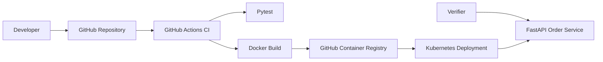

# Architecture

## Components

- `app/main.py` hosts the FastAPI order service.
- `tests/test_main.py` validates the API responses.
- `Dockerfile` builds a non-root container image.
- `.github/workflows/ci.yml` runs tests, builds the image, performs a smoke test, and publishes to GHCR on `main`.
- `k8s/` contains Kubernetes deployment manifests.
